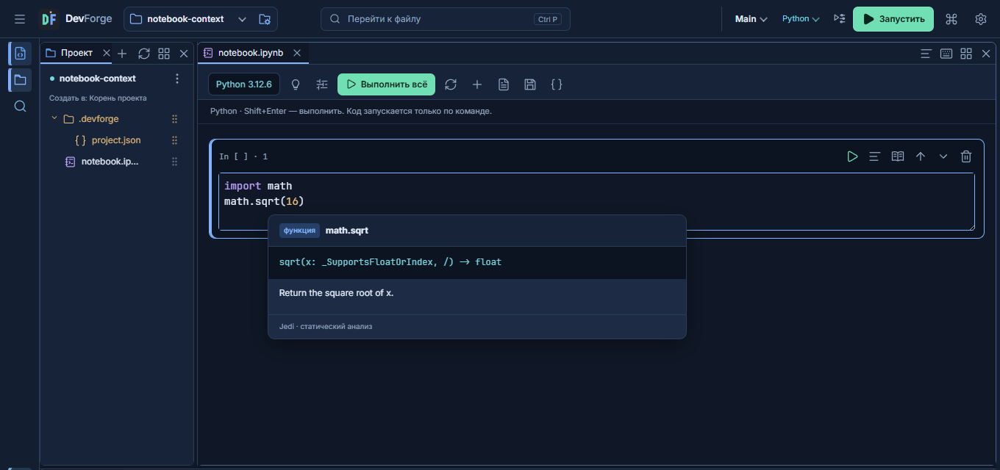

# DevForge

Открытая модульная IDE для C/C++, Python и notebook. Проект начался с задачи
работать с обычными CMake-проектами на Android-планшете с клавиатурой; теперь
общая модель проектов, конфигураций и дополнений используется и на ПК.

**[0.7.0-alpha.3](https://github.com/Bony-Lord/devforge/releases/tag/v0.7.0-alpha.3)
— новая экспериментальная альфа.** Исправления состава дополнений и переключения
оконного режима, универсальный быстрый поиск, умный Markdown и формулы отдельным
аддоном, редактор сочетаний, каталог Open VSX; Vim и карта функций — дополнения.
Совместимость с VSIX пока частичная, полного Extension Host VS Code нет.
[Возможности и ограничения](docs/ALPHA-0.7.md) · [API модулей](docs/EXTENSION-API.md).
На ПК пока остаётся Electron/Chromium; переход оболочки на системный WebView
запланирован отдельно. Стабильный статус не заявляется.

**[0.6.0-beta.1](https://github.com/Bony-Lord/devforge/releases/tag/v0.6.0-beta.1)
— экспериментальная бета для Windows x64 и Android ARM64.** Стабильной не
объявляется. Предыдущая рекомендуемая Android preview —
[0.4.2](https://github.com/Bony-Lord/devforge/releases/tag/v0.4.2).
Проверенной стабильной настольной версии пока нет;
[1.0.0-rc.1](https://github.com/Bony-Lord/devforge/releases/tag/v1.0.0-rc.1)
остаётся нестабильной и не рекомендуется.

## В этой бете

- Общие цвета и состояния редактора, панелей, форм, notebook и магазина;
  заметные команды запуска, поиск в заголовке, категории и поиск настроек.
- Python: настоящие Jedi-подсказки, документация функций по наведению/Ctrl+Q,
  сигнатуры и активный аргумент. Notebook учитывает предыдущие кодовые ячейки.
- Умные отступы и пары скобок в Python/notebook, форматирование и PEP 8
  отдельным дополнением. `%pip` и `!pip` используют окружение проекта.
- Глобальная библиотека дополнений и специализации проекта; каталог с поиском,
  фильтрами, платформами, зависимостями, подробностями и импортом пакетов.
- Отдельные версии Python 3.12/3.13/3.14 для ПК, без изменения системного PATH.
- Создание и подключение шаблонов без обязательного Preview; несколько окон
  проектов на ПК; понятное удаление, архив и восстановление проектов.
- C/C++: CMake/GCC/Clang, clangd, форматтер, Git, точки останова, step over,
  стек и переменные. Возможности зависят от установленных инструментов.
- Настраиваемые ограничения notebook: RAM, CPU Windows, бюджет рабочей папки,
  время ячейки/ноутбука и политика доступности GPU. Это не защитная песочница.

[Изменения дизайна и ограничения](docs/DESIGN-0.6-BETA.md) ·
[Проекты, marketplace и ресурсы](docs/WORKSPACE-MARKETPLACE.md) ·
[Python-инструменты](docs/PYTHON-TOOLS.md) ·
[Шаблоны](docs/PROJECT-TEMPLATES.md)

## Установка

Файлы находятся в [GitHub Releases](https://github.com/Bony-Lord/devforge/releases/tag/v0.6.0-beta.1).

| Платформа | Файл | Особенности |
|---|---|---|
| Windows x64 | `DevForge-0.6.0-beta.1-win-x64-setup.exe` | NSIS, отдельные настройки и проекты сохраняются |
| Android ARM64 | `DevForge-0.6.0-beta.1-modern-arm64.apk` | Android 9+, target SDK36, основной вариант |
| Android ARM64 compat | `DevForge-0.6.0-beta.1-compat-arm64.apk` | target SDK28, прежний путь запуска и системное предупреждение |
| Linux/macOS | Исходники | Установщики этой беты на этих ОС не проверены и не опубликованы |

Выпуск не подписан доверенным сертификатом Windows. Android APK подписаны
ключом проекта. Перед обновлением сделайте резервную копию проектов и настроек.
Modern и compat имеют один application ID: выберите один вариант.

При первом запуске выберите паки/компоненты либо пропустите настройку.
Пустое рабочее пространство не создаёт демонстрационный проект автоматически.
Откройте свою папку или создайте проект по шаблону. GCC, CMake, Python и прочие
инструменты не включены в основной установщик: они загружаются отдельно либо
используются из системы. На Android для нативного окружения возможно одно
системное подтверждение. Основной размер Windows-пакета занимает Electron.

## Проверки и текущие границы

Бета проверяется сценариями настоящего Electron в изолированных проектах,
тестами локальных процессов, Python-ядра и Android JVM/lint. Точный отчёт
`verification.json` приложен к выпуску. Проверка на физическом Android в этом
выпуске не выполнена. Скриншоты сделаны на тестовых проектах без личных данных.

Сторонние пакеты пока расширяют IDE данными, темами, шаблонами и разрешёнными
командами. Полный SDK исполняемых модов, отдельный публичный сервер магазина,
полный Jupyter и полный набор возможностей CLion ещё не реализованы.
Процентная аппаратная квота GPU не поддерживается; CPU-квота реализована
на Windows. Возможности настольных инструментов зависят от вашей установки.

[Автотесты и их запуск](docs/REGRESSION-TESTS.md) ·
[Сборка из исходников](docs/BUILDING.md) ·
[Сообщить об ошибке](https://github.com/Bony-Lord/devforge/issues/new/choose)

## Почему DevForge

Нужна свободная среда с обычной файловой структурой, специализацией под язык
и проект и удобным рабочим местом на планшете и ПК. Организация панелей,
конфигураций и навигации вдохновлена CLion и VS Code. Это самостоятельный
проект: закрытый код и фирменные ресурсы JetBrains/Microsoft не копировались,
связи с этими компаниями нет. [Датированное сравнение с Android IDE и история](docs/HISTORY-README-PRE-BETA.md).

Код приложения — [MIT](LICENSE). Monaco, Sora, Electron, Jedi и другие
компоненты сохраняют собственные лицензии. Соответствующие исходники и notices
сопровождают выпуск. [Лицензии](THIRD_PARTY.md) · [Приватность](docs/PRIVACY.md).
