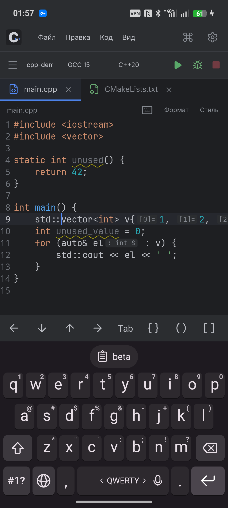
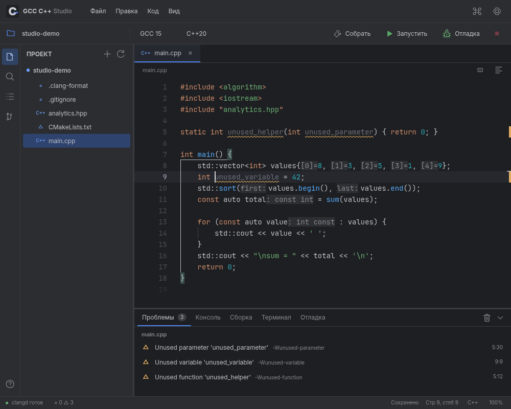

  
  
  
  
  

**Автономная IDE для C/C++ на Android, рассчитанная на планшет с клавиатурой.** GCC, Clang, clangd, CMake, GDB и Git работают прямо на устройстве. Для редактирования, анализа, компиляции и запуска интернет не требуется.

Интерфейс и привычные действия вдохновлены CLion Dark. Это самостоятельное приложение с открытым кодом; оно не связано с JetBrains и не использует закрытый код CLion.

<a href="https://github.com/Bony-Lord/gcc-cpp-studio/releases"><b>Скачать APK →</b></a> · <a href="docs/BUILDING.md">Сборка из исходников</a> · <a href="docs/VERIFICATION.md">Проверки</a> · <a href="THIRD_PARTY.md">Компоненты и лицензии</a>

Раскладка планшета: предыдущий прототип 0.1

Отладчик и два редактора: снимки прототипа 0.1

### Последние изменения в исходниках

Добавлены умный Enter между скобками, переход через существующую закрывающую скобку, исправление отступа при `}`, продолжение блочных комментариев и форматирование завершённого блока через clang-format. Tab стоит перед стрелками на панели клавиатуры. Настройки позволяют выбрать отступы из `.clang-format`, пробелы или табы, размер отступа и ширину табуляции.

В строке состояния появилась кодировка файла: переоткрытие исходных байтов отдельно от преобразования текущего текста. Поддерживаются UTF-8 с BOM/без BOM, UTF-16LE/BE, Windows-1251, KOI8-R, ISO-8859-1, ASCII и Shift_JIS. Непредставимые символы не заменяются молча; сохраняются CRLF/LF.

При переключении вкладок сохраняются анализ, отдельные курсоры и прокрутка; общая история undo сохраняется и для разделённых редакторов. Обычный ввод обходит разбор скобок, неизменённые буферы не копируются повторно для автосохранения, визуальные настройки не перезапускают clangd.

**Проверено на физическом Android:** 64 сценария ввода, вкладок, жестов, форматирования и кодировок, включая настоящую Yandex Keyboard. Исправлены потеря Enter через IME, сбой отрисовки выделения до первого кадра, устаревшая подсветка после смены файла и рассинхронизация при вставке смешанных CRLF/LF. На компьютере пройдены ещё 111 проверок. Условия и ограничения приведены в [отчёте](docs/VERIFICATION.md).

### Возможности

| Область | Что работает |
|---|---|
| Компиляторы | Настоящий GNU GCC 15.2 и LLVM Clang 21.1; C/C++, Debug и Release, дополнительные флаги |
| Стандарты | C89–C23, C++98–C++26 и GNU-варианты; поддержка новых стандартов зависит от компилятора и библиотеки |
| Умный редактор | Нативный Sora Editor, JetBrains Mono, семантические цвета clangd, автодополнение, документация и подсказки типов |
| Анализ | clangd и clang-tidy, ошибки при вводе, неизвестные имена/методы, предупреждения, серые неиспользуемые символы |
| Навигация | Определения, использования, структура файла, поиск файлов, переход к строке |
| Изменение кода | Переименование символов, быстрые исправления, clang-format с редактором профиля, YAML и проверяемым предпросмотром |
| Проекты | Файл, все исходники или CMake/Ninja; фактическая база команд CMake передаётся clangd |
| Запуск | stdin, stdout/stderr, аргументы, код завершения, остановка, локальная оболочка |
| Отладка | GDB/MI, точки останова, продолжение/пауза, шаги, стек, переменные, выражения наблюдения, PTY для ввода/вывода |
| Git | Локальные репозитории, индекс, коммиты, журнал, ветки, сравнение HEAD с рабочей копией, клонирование HTTPS |
| Рабочее место | Независимые масштабы UI и кода, два редактора рядом/сверху, изменяемые границы, сохранение расположения |
| Файлы | Открытие общей папки без копирования, обычная структура PC-проектов, атомарное автосохранение, локальная история, импорт/экспорт |
| Android-ввод | Нативное выделение и буфер обмена, отключённое автоисправление, опциональная панель стрелок/символов, удержание клавиш |
| Языки интерфейса | Русский и English, выбор сохраняется между запусками |

### Установка и первый запуск

Нужен современный Android System WebView.

1. Скачайте **GCC-CPP-Studio-arm64.apk** со страницы Releases и установите на ARM64-устройство.
2. Первый запуск распаковывает инструменты. Требуется примерно **1.2 ГБ свободного места** с учётом APK и рабочего окружения; оставьте запас для проектов.
3. Откройте `hello-cpp`, выберите компилятор и стандарт, нажмите **Запустить**.
4. Откройте существующий PC-проект через **Файл → Открыть папку устройства** либо получите его через **Git → клонирование HTTPS**.

Открытие папки устройства редактирует оригиналы без копирования; Android запрашивает доступ к общей памяти. Импорт через системный выбор папки создаёт отдельную копию. Перед удалением приложения экспортируйте приватные проекты: Android удаляет его внутренние данные. Сборочные файлы и исполняемые программы хранятся в приватном кэше, а рабочая папка запуска — **корень проекта**: `std::ifstream("data/input.txt")` читает файл именно из проекта.

### Масштаб и окна

- **Ctrl + / Ctrl −** или Ctrl + колесо — масштаб кода; **Ctrl 0** — 100%.
- **Ctrl Alt + / Ctrl Alt −** — масштаб всего интерфейса; **Ctrl Alt 0** — 100%.
- Размер шрифта, оба масштаба и тема также доступны в настройках.
- **Ctrl \\** — разделить редактор справа. В меню «Вид» доступны разделение снизу и возврат к одному редактору.
- Перетаскивайте границы дерева проекта, нижней панели и редакторов. Размеры сохраняются.
- Двумя пальцами в редакторе можно менять масштаб кода.
- На телефоне экранная клавиатура открывается касанием кода; векторная кнопка клавиатуры над редактором вызывает её вручную.
- Панель над клавиатурой содержит четыре направления, Tab, скобки, символы и действия буфера обмена. Её можно прокрутить и отключить в настройках.
- В настройках клавиатуры задаётся **перекрытие 0–100%**: 100% оставляет интерфейс на месте, 0% сжимает окно на всю высоту клавиатуры, промежуточные значения сжимают его частично. Курсор прокручивается выше клавиатуры.

### Клавиатура

| Действие | Клавиши |
|---|---|
| Все команды | Ctrl Shift P / Ctrl Shift A |
| Открыть файл / сохранить | Ctrl P / Ctrl S |
| Собрать / запустить | Ctrl F9 или F9 / F5 или Shift F10 |
| Начать отладку | Shift F9 |
| Продолжить отладку / шаг | F9 / F8 |
| Войти в функцию / выйти | F7 / Shift F8 |
| Остановить | Ctrl F2 / Shift F5 |
| Подсказки / исправления | Ctrl Space / Alt Enter |
| Определение / использования | Ctrl B или F12 / Shift F12 |
| Переименовать | Shift F6 / F2 |
| Форматировать | Ctrl Alt L / Shift Alt F |
| Настройки | Ctrl Alt S / Ctrl , |
| Панель / терминал | Ctrl J / Alt F12 |

В отладке `F9` означает продолжение; для сборки остаётся `Ctrl F9`. Для точки останова нажмите в левом поле рядом с номером строки.

### Границы текущей версии

- Это **предварительная версия 0.2**, охватывающая основное рабочее ядро C/C++ IDE. Плагины IntelliJ, Code With Me, GUI-дизайнеры, полный набор рефакторингов и интеграции настольного CLion сюда не перенесены.
- Программы собираются для **Android ARM64/Bionic**. GCC использует **libc++**, а не GNU libstdc++; GNU PBDS и другие расширения libstdc++ не поставляются. `bits/stdc++.h` — отдельный совместимый заголовок над стандартными заголовками libc++.
- clangd использует фронтенд Clang и выбранный стандарт. Его диагностика и диагностика GCC могут различаться. Серым отмечается неиспользуемый код, подтверждённый анализатором; произвольную публичную функцию нельзя надёжно объявить неиспользуемой только по одному файлу.
- Графическая отладка покрывает основные команды GDB; визуализация сложных контейнеров зависит от доступных pretty-printers.
- Обычная вкладка терминала — оболочка с выводом команд, без полноэкранного PTY. Отладчик получает отдельный PTY для программы.
- Проверено на **realme RMX3951, Android 16, ARM64**. Раскладки планшета проверены через изменение размеров WebView. Настоящий планшет и физическая клавиатура отдельно ещё не проверялись.
- APK объявляет Android 9 как минимум. Другие версии Android и устройства не прошли полный набор физических проверок.

### Разработка

Хост и нативный редактор используют Java и Sora Editor; оболочка — JavaScript/CSS. Скрытые модели Monaco служат для LSP, сравнения файлов и предпросмотра. Ввод текста и отрисовка кода не зависят от цикла JavaScript WebView. Нативное окружение собирается из зафиксированных пакетов Termux/TUR с проверкой SHA256, переносом путей и сохранением лицензий. Сам Termux устанавливать не нужно.

Исходники приложения — **MIT**. Компиляторы, отладчик, Git и библиотеки сохраняют собственные лицензии. Рядом с APK в Releases находится архив соответствующих исходников GNU/copyleft-компонентов, патчей и рецептов сборки. Подробности — в [THIRD_PARTY.md](THIRD_PARTY.md).

В 0.2 клавиатуре задаётся режим видимого текста без автокоррекции и смены регистра. Проверено настоящими экранными клавишами Yandex Keyboard, включая `std `, удержание Backspace, выделение и Ctrl+C/V. Диагностика показывается независимо от семантических цветов и подсказок типов; изменения в clangd передаются инкрементально. Измерения и ограничения приведены в [отчёте проверок](docs/VERIFICATION.md).
