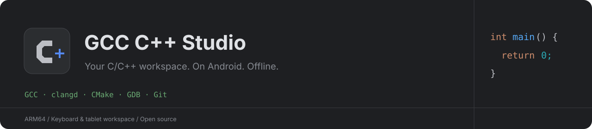
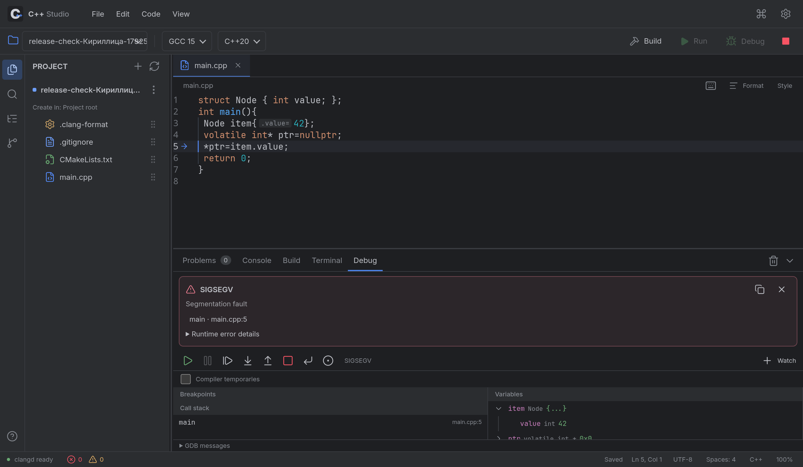
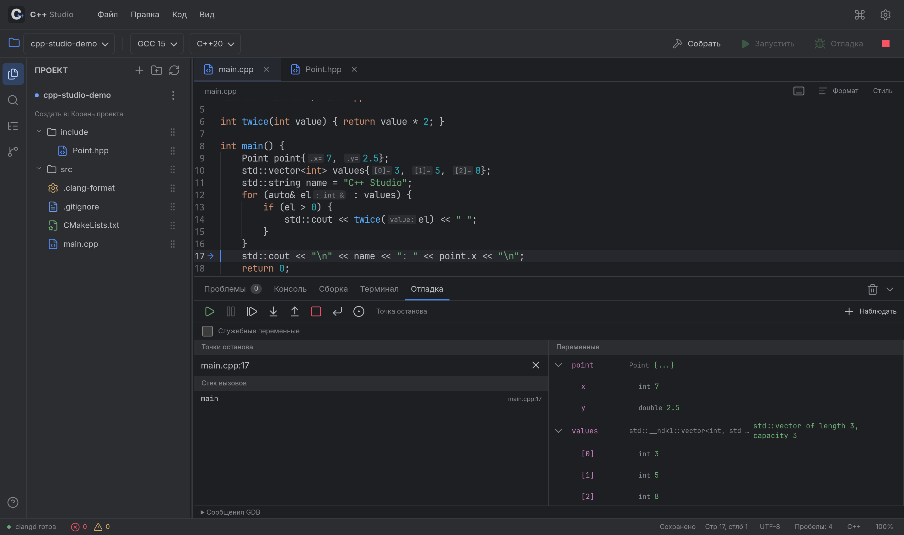
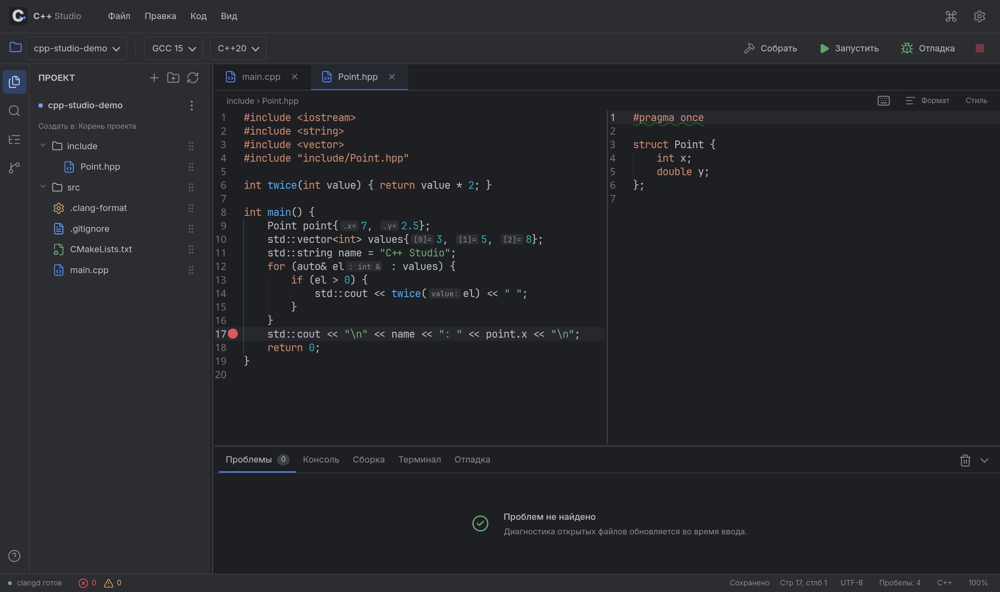
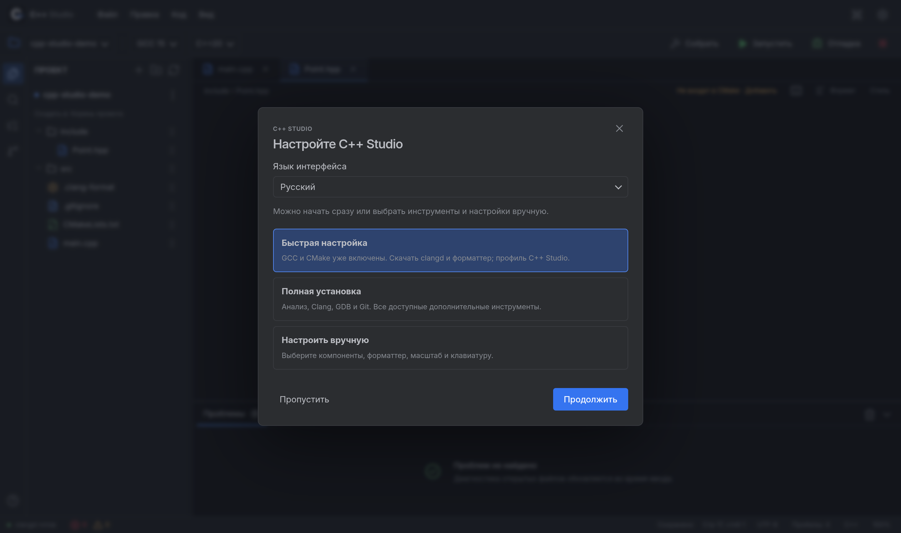

  
  
  
  
  

> **Android [0.3.4 — workspace preview](https://github.com/Bony-Lord/gcc-cpp-studio/releases/tag/v0.3.4):** окна файлов и группы вкладок, подсветка привязки с задержкой и отменой, анимации/инерция, полная PC-клавиатура и упрощённый режим без оконника. На Xiaomi Pad 6 прошли 73 целевые проверки. Это предварительный выпуск со старым target SDK28. [Управление и ограничения](https://github.com/Bony-Lord/gcc-cpp-studio/blob/v0.3.4/docs/WORKSPACE-0.3.4.md). Для возврата к прежнему интерфейсу сохранена [0.3.2 preview](https://github.com/Bony-Lord/gcc-cpp-studio/releases/tag/v0.3.2); полная стабильность обеих сборок не заявляется. Рекомендация 0.3.1 снята из-за подтверждённого ANR.
>
> **Последний выпуск [1.0.0-rc.1](https://github.com/Bony-Lord/gcc-cpp-studio/releases/tag/v1.0.0-rc.1) — НЕСТАБИЛЬНЫЙ, только для тестирования.** В нём обнаружены проблемы настольного интерфейса, анализа кода, CMake и управления запуском. Исправления 1.0.0-rc.2 находятся в разработке и пока не выпущены. Более ранней стабильной настольной версии нет.
>
> [Архитектура Android](docs/MODERN-ANDROID.md) · [Настольная версия](docs/DESKTOP.md) · [Runtime-проверки](docs/RUNTIME-CHECKS.md) · [Состояние кандидата](docs/RELEASE-1.0-WORK.md).

**Автономная IDE для C/C++ на Android, рассчитанная на планшет с клавиатурой.** GCC, Clang, clangd, CMake, GDB и Git работают прямо на устройстве. Для редактирования, анализа, компиляции и запуска интернет не требуется.

Интерфейс и привычные действия вдохновлены CLion Dark. Это самостоятельное приложение с открытым кодом; оно не связано с JetBrains и не использует закрытый код CLion.

<a href="https://github.com/Bony-Lord/gcc-cpp-studio/releases/tag/v0.3.2"><b>Скачать Android 0.3.2 preview →</b></a> · <a href="docs/BUILDING.md">Сборка из исходников</a> · <a href="docs/VERIFICATION.md">Проверки</a> · <a href="THIRD_PARTY.md">Компоненты и лицензии</a>

**История 0.3.1:** исправлена обрезка прокрученного редактора при масштабировании, переработаны создание/переименование в дереве и панель клавиатуры, добавлены Android-сочетания отладчика и удаление GCC с восстановлением из APK. [Изменения](CHANGELOG.md) · [Галерея](docs/GALLERY.md) · [Готовые примеры](examples/README.md) · [Проверка лицензий](docs/LICENSE-AUDIT.md) · [Приватность](docs/PRIVACY.md).

Отладчик, разделение редактора и начальная настройка

Следующий архитектурный этап — [система аддонов, минимальный APK и официальный маркетплейс](docs/ADDONS-ROADMAP.md). Это **план**, текущий APK пока содержит GCC/CMake. CMake запланирован обязательным аддоном, компиляторы — выборочными.

### Зачем создаётся C++ Studio

Проект вырос из конкретной потребности: работать с C++ на Android-планшете с клавиатурой так же привычно, как в настольной IDE. Открыть папку проекта с ПК, сохранить её структуру, собирать через GCC/CMake, видеть ошибки до запуска и разбирать значения структур в отладчике — в одном приложении, без удалённого компьютера.

CLion служит ориентиром по организации рабочего места: тёмная тема, дерево проекта, окна инструментов, навигация по коду, серые неиспользуемые символы и быстрые исправления. На Android к этому добавляются сенсорный ввод, экранная клавиатура, жесты, небольшие экраны и ограничения системы. C++ Studio объединяет открытые инструменты и адаптирует их к этим условиям. Закрытые компоненты и оформление JetBrains в приложение не включены.

### Сравнение с похожими приложениями

Сравнение проверено **20 октября 2026 года** по официальным описаниям разработчиков. Столбец C++ Studio относится к **0.3.1**. «Не заявлено» означает, что функция не описана в приведённом источнике; это не утверждение, что её нет. Независимого сравнительного теста скорости и стабильности пока не проводилось.

| Возможность | C++ Studio 0.3.1 | [Cxxdroid][cxxdroid] | [Coding C++][coding-cpp] | [Termux][termux] с редактором |
|---|---|---|---|---|
| Основной сценарий | Работа с C/C++-проектами на планшете с клавиатурой | Обучение C/C++, готовые библиотеки и примеры | Быстро написать и запустить C++-программу | Настраиваемое терминальное окружение Linux на Android |
| Сборка без интернета | GCC включён; Clang устанавливается отдельно | Локальный компилятор Clang | Локальный компилятор LLVM | Clang и другие инструменты после установки пакетов |
| Анализ при вводе | clangd: диагностика, семантика, автодополнение; отдельный пакет | Анализ и предсказание кода заявлены, часть возможностей Premium | Подсветка и подсказки кода | Зависит от редактора и настройки LSP |
| CMake-проекты | CMake/Ninja включены, compile_commands.json для clangd | Интеграция CMake не заявлена | Интеграция CMake не заявлена | CMake доступен как пакет; сборка из терминала |
| Отладка | GDB: точки останова, шаги, стек, раскрываемые структуры и контейнеры; отдельный пакет | Отладчик указан в списке будущих функций | Пошаговый отладчик не заявлен | GDB/LLDB доступны; интерфейс зависит от выбранных инструментов |
| Форматирование | clang-format, профили и предпросмотр, умные отступы | Автоматические отступы; редактор профилей не заявлен | Форматирование кода | Настраивается через пакеты и редактор |
| Git | Встроенные действия, HTTPS-клонирование; отдельный пакет | Не заявлено | Не заявлено | Git устанавливается через менеджер пакетов |
| Библиотеки и расширение окружения | Набор инструментов пока ограничен четырьмя дополнительными пакетами | Собственный репозиторий, Boost/SQLite, SDL2 и другие библиотеки | Заявлена поддержка библиотек и стандартных функций | Широкий каталог пакетов APT |
| Клавиатура и рабочее место | Нативный редактор, панель символов, разделение окон, масштаб UI/кода | Панель символов, темы, вкладки | Панель символов, работа с методами ввода, масштаб кода | Горячие клавиши, мышь; интерфейс выбранного редактора |
| Исходники и распространение | Код приложения MIT, лицензии инструментов отдельно; без рекламы и покупок | В Google Play указаны реклама и покупки; часть компонентов закрыта | В Google Play указаны реклама и покупки | Открытый код, установка пакетов по выбору |

[cxxdroid]: https://play.google.com/store/apps/details?id=ru.iiec.cxxdroid&hl=en
[coding-cpp]: https://play.google.com/store/apps/details?id=com.kvassyu.coding2.cpp&hl=en
[termux]: https://termux.dev/en/

Источники: [описание Cxxdroid][cxxdroid], [описание Coding C++][coding-cpp], [сайт CodingCPP](https://kvassyu-repo.web.app/CodingCPP/index.html), [сайт Termux][termux]. Условия и возможности сторонних приложений могут меняться.

Выбор зависит от задачи: Cxxdroid предлагает готовую учебную среду и библиотеки, Coding C++ — простой старт, Termux — гибкость окружения. C++ Studio создаётся для тех, кому нужен единый графический рабочий процесс с GCC, CMake и отладчиком на планшете.

**Текущее ограничение проекта — зрелость.** Это предварительная версия: поведение ввода, жестов и расположения панелей ещё дорабатывается. Первый разбор тяжёлых заголовков может занимать несколько секунд. В кандидате 1.0 используется API 36 и новый механизм исполнения; физическая ARM64-проверка этой версии ещё требуется. Полного соответствия рефакторингам, анализу, интеграциям и надёжности CLion пока нет. Замеры и проверенные сценарии доступны в [отчёте](docs/VERIFICATION.md), ограничения платформы — в [PLATFORMS.md](docs/PLATFORMS.md).

Нашли проблему или хотите повлиять на развитие? [Сообщите об ошибке или предложите улучшение](https://github.com/Bony-Lord/gcc-cpp-studio/issues/new/choose). Особенно полезны воспроизводимые примеры: модель устройства, версия Android, тип клавиатуры и короткий проект без личных данных.

### История 0.3.0

- Основной APK стал примерно вдвое меньше: GCC, CMake и Ninja входят в комплект, анализ/форматирование, Clang, GDB и Git устанавливаются отдельно через «Настройки → Инструменты». После установки они работают без интернета. При обновлении старые инструменты сохраняются.
- Отладчик показывает раскрываемые поля структур и элементы контейнеров, типы и строки; подключены визуализаторы libc++. Добавлены список точек останова, Ctrl+F8 и выполнение до курсора. F8 выполняет строку с обходом, F7 входит в пользовательскую функцию и пропускает стандартную библиотеку, Shift+F8 выходит из функции.
- Повторное нажатие активной левой панели скрывает её. Разделители занимают 6 px и не увеличиваются при наведении; невидимая область захвата, порог движения, обработка отмены и стрелки клавиатуры помогают менять размеры.
- Ctrl+Space оставлен переключению раскладки Android, Ctrl+Shift+Space вызывает автодополнение, Ctrl+Alt+Space — параметры. Переключение раскладки подтверждено на физической клавиатуре Xiaomi.
- Мастер создаёт C/C++-файлы, h/hpp, пару файлов класса с пространством имён, CMakeLists.txt и .cmake во вложенных папках. Он предлагает подключить исходник к CMake или создать конфигурацию для исполняемого файла/библиотеки.
- Компактные списки с поиском открываются возле кнопок поверх нативного редактора; рядом с компиляторами есть скачать/удалить. Короткие анимации с учётом reduced motion; подписи интерфейса не выделяются как текст, поля ввода/вывода доступны для копирования.
- Дерево помнит выбранную папку/файл и показывает, где будет создан новый элемент. Пустое место или касание вне дерева сбрасывает выбор. Мышью можно перетаскивать строку, пальцем — за ручку справа; перенос сохраняет открытые данные, кодировки, историю и точки останова. Пути в CMake/#include после переноса пока нужно проверить.
- Кнопка «Сообщить об ошибке» открывает форму GitHub с версией и устройством, без автоматической публикации.
- При первом запуске мастер предлагает язык, быструю/полную/ручную настройку или пропуск. Профили форматтера C++ Studio и CLion разделены; настройки существующих проектов сохраняются без явного выбора замены.
- Отдельная кнопка создаёт папки. Меню файла, папки и корня открывает их в системном проводнике через Android DocumentsProvider, включая приватные проекты IDE (просмотр/копирование).
- Строки дерева компактные (28 px), вкладки файлов — 36 px. Полупрозрачные направляющие показывают вложенность сразу, без clangd; активный блок заметнее. Место точек останова постоянно, строка подсвечивается лёгким красным фоном.
- clang-tidy вынесен в настройку расширенного анализа. На планшете повторные правки с `bits/stdc++.h` дали диагностику за 180–253 мс; первый разбор всё ещё занимает около 3 секунд. Это инструментальные замеры конкретного примера.

Сценарии ввода, кодировок и умных отступов 0.2 сохранены. Новые проверки выполнены на Xiaomi Pad 6 / Android 14; подробности и границы — в [отчёте](docs/VERIFICATION.md).

**В 1.0 реализован новый механизм запуска с API 36** и настольные хосты. Google Play ещё не проверен; modern APK включает все нативные инструменты, отключение компонентов не уменьшает его размер. См. [PLATFORMS.md](docs/PLATFORMS.md).

### Возможности

| Область | Что работает |
|---|---|
| Компиляторы | Настоящий GNU GCC 15.2 и LLVM Clang 21.1; C/C++, Debug и Release, дополнительные флаги |
| Стандарты | C89–C23, C++98–C++26 и GNU-варианты; поддержка новых стандартов зависит от компилятора и библиотеки |
| Умный редактор | Нативный Sora Editor, JetBrains Mono, семантические цвета clangd, автодополнение, документация и подсказки типов |
| Анализ | clangd и clang-tidy, ошибки при вводе, неизвестные имена/методы, предупреждения, серые неиспользуемые символы |
| Навигация | Определения, использования, структура файла, поиск файлов, переход к строке |
| Изменение кода | Переименование символов, быстрые исправления, clang-format с редактором профиля, YAML и проверяемым предпросмотром |
| Проекты | Файл, все исходники или CMake/Ninja; фактическая база команд CMake передаётся clangd |
| Запуск | stdin, stdout/stderr, аргументы, код завершения, остановка, локальная оболочка |
| Отладка | GDB/MI, точки останова, продолжение/пауза, шаги, стек, переменные, выражения наблюдения, PTY для ввода/вывода |
| Git | Локальные репозитории, индекс, коммиты, журнал, ветки, сравнение HEAD с рабочей копией, клонирование HTTPS |
| Рабочее место | Независимые масштабы UI и кода, два редактора рядом/сверху, изменяемые границы, сохранение расположения |
| Файлы | Открытие общей папки без копирования, обычная структура PC-проектов, атомарное автосохранение, локальная история, импорт/экспорт |
| Android-ввод | Нативное выделение и буфер обмена, отключённое автоисправление, опциональная панель стрелок/символов, удержание клавиш |
| Языки интерфейса | Русский и English, выбор сохраняется между запусками |

### Установка и первый запуск

Нужен современный Android System WebView. Компилятор по умолчанию — GCC; остальные инструменты выбираются отдельно.

1. Скачайте **Cpp-Studio-arm64.apk** со страницы Releases и установите на ARM64-устройство.
2. Первый запуск распаковывает GCC/CMake/Ninja. Для основного APK и окружения оставьте минимум **600 МБ свободного места**, для обновления и загрузки дополнительных инструментов — больше.
3. Для семантики, диагностики и форматирования установите «Анализ и форматирование» в настройках инструментов. Откройте `hello-cpp`, выберите компилятор и стандарт, нажмите **Запустить**.
4. Откройте существующий PC-проект через **Файл → Открыть папку устройства** либо получите его через **Git → клонирование HTTPS**.

Открытие папки устройства редактирует оригиналы без копирования; Android запрашивает доступ к общей памяти. Импорт через системный выбор папки создаёт отдельную копию. Перед удалением приложения экспортируйте приватные проекты: Android удаляет его внутренние данные. Сборочные файлы и исполняемые программы хранятся в приватном кэше, а рабочая папка запуска — **корень проекта**: `std::ifstream("data/input.txt")` читает файл именно из проекта.

### Масштаб и окна

- **Ctrl + / Ctrl −** или Ctrl + колесо — масштаб кода; **Ctrl 0** — 100%.
- **Ctrl Alt + / Ctrl Alt −** — масштаб всего интерфейса; **Ctrl Alt 0** — 100%.
- Размер шрифта, оба масштаба и тема также доступны в настройках.
- **Ctrl \\** — разделить редактор справа. В меню «Вид» доступны разделение снизу и возврат к одному редактору.
- Перетаскивайте границы дерева проекта, нижней панели и редакторов. Размеры сохраняются.
- Двумя пальцами в редакторе можно менять масштаб кода.
- На телефоне экранная клавиатура открывается касанием кода; векторная кнопка клавиатуры над редактором вызывает её вручную.
- Панель над клавиатурой содержит четыре направления, Tab, скобки, символы и действия буфера обмена. Её можно прокрутить и отключить в настройках.
- В настройках клавиатуры задаётся **перекрытие 0–100%**: 100% оставляет интерфейс на месте, 0% сжимает окно на всю высоту клавиатуры, промежуточные значения сжимают его частично. Курсор прокручивается выше клавиатуры.

### Клавиатура

| Действие | Клавиши |
|---|---|
| Все команды | Ctrl Shift P / Ctrl Shift A |
| Открыть файл / сохранить | Ctrl P / Ctrl S |
| Собрать / запустить | Ctrl F9 или F9 / F5 или Shift F10 |
| Начать отладку | Shift F9 |
| Точка останова / до курсора | Ctrl F8 / Alt F9 |
| Продолжить отладку / шаг | Ctrl Alt R / Ctrl Alt →; также F9 / F8 |
| Войти в функцию / выйти | Ctrl Alt ↓ / Ctrl Alt ↑; также F7 / Shift F8 |
| Остановить | Ctrl F2 / Shift F5 |
| Подсказки / исправления | Ctrl Shift Space / Alt Enter |
| Определение / использования | Ctrl B или F12 / Shift F12 |
| Переименовать | Shift F6 / F2 |
| Форматировать | Ctrl Alt L / Shift Alt F |
| Настройки | Ctrl Alt S / Ctrl , |
| Панель / терминал | Ctrl J / Alt F12 |

В отладке `F9` означает продолжение; для сборки остаётся `Ctrl F9`. Если Bluetooth-клавиатура отправляет вместо F8 команду громкости, используйте Ctrl Alt →. Дополнительно: Ctrl Alt D — начать отладку, Ctrl Alt B — точка, Ctrl Alt K — остановить, Ctrl Alt T — до курсора. Для точки останова также нажмите в левом поле рядом с номером строки. Наведение мыши показывает название действия и сочетание.

### Границы текущей версии

- Это **предварительная версия 0.3.1**, охватывающая основное рабочее ядро C/C++ IDE. Плагины IntelliJ, Code With Me, GUI-дизайнеры, полный набор рефакторингов и интеграции настольного CLion сюда не перенесены.
- Программы собираются для **Android ARM64/Bionic**. GCC использует **libc++**, а не GNU libstdc++; GNU PBDS и другие расширения libstdc++ не поставляются. `bits/stdc++.h` — отдельный совместимый заголовок над стандартными заголовками libc++.
- clangd использует фронтенд Clang и выбранный стандарт. Его диагностика и диагностика GCC могут различаться. Серым отмечается неиспользуемый код, подтверждённый анализатором; произвольную публичную функцию нельзя надёжно объявить неиспользуемой только по одному файлу.
- Графическая отладка покрывает основные команды GDB; визуализация сложных контейнеров зависит от доступных pretty-printers.
- Обычная вкладка терминала — оболочка с выводом команд, без полноэкранного PTY. Отладчик получает отдельный PTY для программы.
- Проверено на **realme RMX3951, Android 16** и **Xiaomi Pad 6, Android 14**, ARM64. Переключение раскладки подтверждено физической клавиатурой; жесты и комбинации дополнительно проверялись через Android-ввод. Полный стресс всех Bluetooth-клавиатур и тачпадов не подтверждён.
- APK объявляет Android 9 как минимум. Другие версии Android и устройства не прошли полный набор физических проверок.

### Разработка

Хост и нативный редактор используют Java и Sora Editor; оболочка — JavaScript/CSS. Скрытые модели Monaco служат для LSP, сравнения файлов и предпросмотра. Ввод текста и отрисовка кода не зависят от цикла JavaScript WebView. Нативное окружение собирается из зафиксированных пакетов Termux/TUR с проверкой SHA256, переносом путей и сохранением лицензий. Сам Termux устанавливать не нужно.

Исходники приложения — **MIT**. Компиляторы, отладчик, Git и библиотеки сохраняют собственные лицензии. Рядом с APK в Releases находится архив соответствующих исходников GNU/copyleft-компонентов, патчей и рецептов сборки. Подробности — в [THIRD_PARTY.md](THIRD_PARTY.md).

В 0.2 клавиатуре задаётся режим видимого текста без автокоррекции и смены регистра. Проверено настоящими экранными клавишами Yandex Keyboard, включая `std `, удержание Backspace, выделение и Ctrl+C/V. Диагностика показывается независимо от семантических цветов и подсказок типов; изменения в clangd передаются инкрементально. Измерения и ограничения приведены в [отчёте проверок](docs/VERIFICATION.md).
