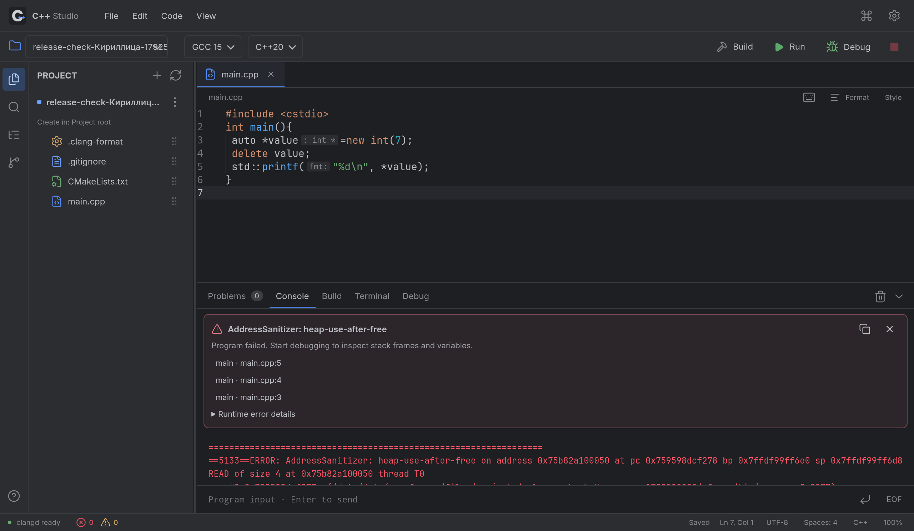
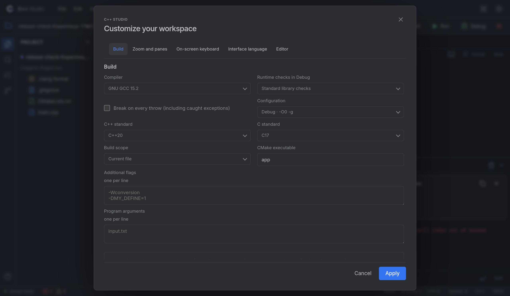
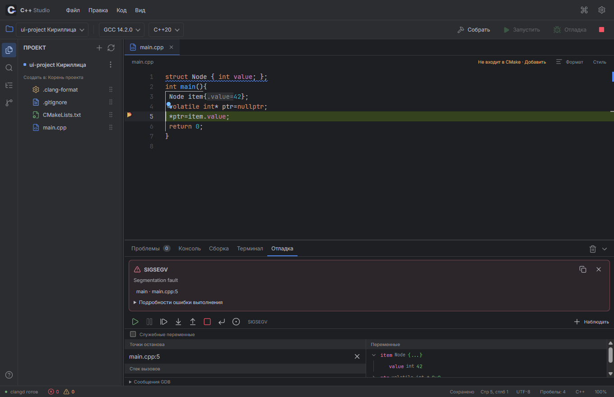

# C++ Studio: галерея

## 1.0.0-rc.1

Новые снимки получены из работающего приложения: Android 16 / API 36 **в эмуляторе x86_64** и Windows x64. Это реальные результаты собственных тестовых программ; системные панели и пользовательские проекты не включены. Снимки эмулятора не подменяют физическую проверку ARM64.

Отладчик останавливается при разыменовании nullptr, открывает строку проекта и раскрывает `Node.value`:

Clang ASan обнаруживает чтение после delete и показывает строки ошибочного чтения, освобождения и выделения:

Настройки разделены на категории; кнопки применения остаются доступны при прокрутке:

Та же структура проекта и интерфейс отладки на Windows с настоящими GCC/GDB:

## 0.3.1: физический планшет

Снимки сделаны из работающего приложения на Xiaomi Pad 6 / Android 14. Видно только окно IDE: системных часов, заряда, уведомлений и пользовательских проектов здесь нет. Это демонстрационные проекты из [examples](../examples/README.md); код и вывод не дорисовывались.

## Файлы и запуск

`console-files` собирается настоящим GCC/CMake. Программа читает `data/input.txt` из корня проекта и печатает `C++ Studio: 42`.

Подсветка CMake и обычная структура проекта, пригодная для переноса с ПК:

## Создание и переименование

Одна кнопка открывает компактный список около дерева. Тип создаётся сразу со свободным именем, после чего имя редактируется в строке дерева.

При переименовании файла заранее выделяется имя без расширения. Enter сохраняет, Escape завершает редактирование.

## Форматирование и инструменты

Профиль C++ Studio: четыре пробела, `auto& value`, `auto *pointer`, пробелы вокруг `:` в range-for. Предпросмотр выполняет установленный clang-format; параметры доступны в форме и YAML.

GCC можно удалить и восстановить из APK без интернета. Анализ/форматтер, Clang, GDB и Git загружаются и удаляются отдельно; CMake/Ninja остаются в основе.

## Отладка и диагностика

`debug-containers` показывает пользовательскую структуру и контейнеры libc++. Видна вложенность раскрытых `point` и `values`; строки переменных имеют компактную высоту.

Наведение мыши на шаг показывает действие и альтернативное сочетание для Android-клавиатуры:

В отдельной демонстрационной копии намеренно добавлен `missing_function(values)`. Ошибка приходит от clangd, её можно открыть из панели проблем; наведение на подчёркивание также показывает нативную диагностическую подсказку.

Первый разбор заголовков может занимать несколько секунд. Эти снимки демонстрируют функции; они не являются сравнительным бенчмарком стабильности или скорости. Методика и ограничения — в [VERIFICATION.md](VERIFICATION.md).
