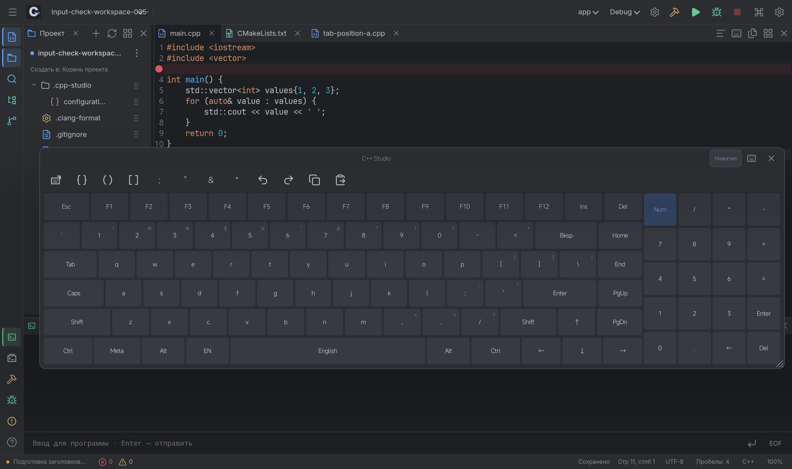
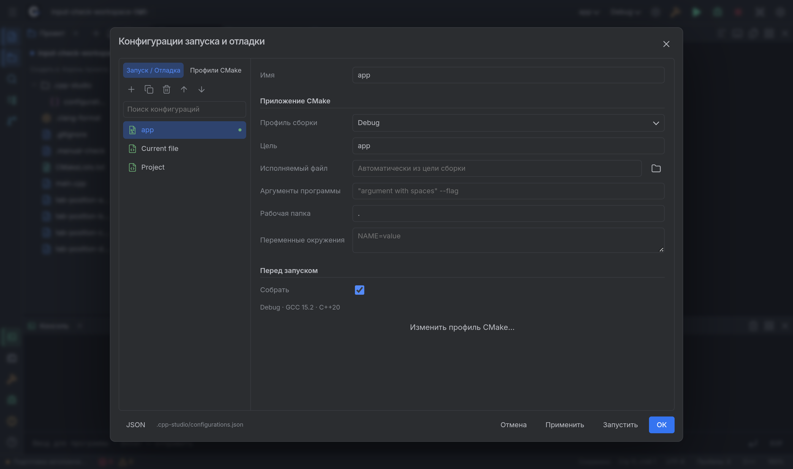

# Android 0.3.5 — клавиатура и отрисовка окон

Предварительное исправление поверх 0.3.4. Поддерживающая ветка сохраняет target SDK28; предупреждение Google Play о старом target SDK этим выпуском не исправлено.

## Клавиатура

На заголовке плавающей клавиатуры появилась кнопка **Нажатие / Удержание**. Выбор сохраняется и синхронизируется с настройкой модификаторов.

- **Нажатие:** обычный символ вводится при отпускании. Ctrl/Alt/Shift можно нажать заранее для следующей клавиши. Двойное нажатие или долгое удержание модификатора закрепляет его до следующего нажатия.
- **Удержание:** клавиша срабатывает при касании; печатные символы и навигация повторяются при удержании. Модификатор действует, пока соответствующий палец находится на клавише. Сочетания команд не запускают повторные запросы автодополнения при удержании.
- Маленькие серые подписи показывают символы Shift над цифрами и пунктуацией. Они остаются видимыми вместе с основным обозначением клавиши.
- Все касания обрабатывает один контроллер по стабильному pointer ID. Порядок пальцев в событии может меняться; отпускание одного Shift не снимает второй. В режиме нажатия сочетание сохраняет модификаторы, действовавшие при касании буквы, даже если палец с Shift отпущен раньше.
- Отмена жеста снимает все временные удержания и повторы. Во время сочетания клавиши не перестраиваются; смена языка откладывает перестроение до отпускания пальцев. Перенос клавиатуры не передаётся другому пальцу после отпускания первого.

## Окна и предпросмотр

В 0.3.4 после анимации содержимое плавающего окна могло остаться в промежуточных координатах. Это воспроизводилось без изменения текста: прямоугольник содержимого расходился с окном, а ручное изменение границы восстанавливало его.

Исправление использует штатный `DockviewApi.layout(width, height, true)` после фактического завершения анимаций. Завершение старой отменённой анимации не перезаписывает новую раскладку. Контейнер имеет одного владельца пересчёта размеров; нативный код следует геометрии области содержимого группы, а не промежуточному overlay.

Зоны привязки вычисляются по текущим положениям групп. **Фактическая привязка происходит при отпускании**, после короткого ожидания над зоной. Во время движения виден бледный предпросмотр, который становится заметнее по готовности; раскладка не перестраивается под удерживаемым окном. Полоса у края экрана — 30 CSS px; у окна — до 64 px с ограничением для узких групп. Правый край экрана имеет приоритет перед заголовком; центральная часть заголовка остаётся местом объединения вкладок даже у верхней границы.

При переходе в плавающий режим окно плавно уменьшается. Его можно увести за экран: небольшое смещение возвращается после отпускания, а при видимости менее 30% окно сворачивается к боковой панели без удаления документа. Сворачивание, закрытие и перестановка вкладок анимированы. Второй палец не перехватывает перенос или растягивание. При отделении сохраняются размеры навигации/вывода; сохранённые размеры прикреплённых и плавающих панелей восстанавливаются отдельно, без повторного вычитания рамки.

Повторное нажатие на выбранную кнопку слева скрывает окно. Разные кнопки соответствующего ряда переключают одно общее окно. Наша клавиатура — основной вариант по умолчанию; в настройках и на её заголовке остаётся переход к системной.

За основу взяты существующий свободный Dockview Core, его API пересчёта и встроенная анимация вкладок, а также стандартная схема Android MotionEvent. Новые закрытые компоненты и дополнительные библиотеки не включены.

Источники реализации: [Dockview — sizing](https://dockview.dev/docs/core/sizing/), [rendering panels](https://dockview.dev/docs/core/panels/rendering/), [floating groups](https://dockview.dev/docs/core/groups/floatingGroups/), [theme/tabAnimation](https://dockview.dev/docs/core/theming/), [Android — multi-touch pointer IDs](https://developer.android.com/develop/ui/views/touch-and-input/gestures/multi).

## Проверка

На физическом Xiaomi Pad 6 / Android 14 проверяются 24 новых сценария в `verification-input-layout-035.json`: режимы клавиш, подписи Shift, разные порядки отпускания и перестановка индексов пальцев, два Shift, Ctrl+Alt+Space тремя пальцами, повтор и отмена, отсутствие захвата вторым пальцем, точное совпадение геометрии после анимации/в предпросмотре и перенос в уже перемещённую группу.

Дополнительные сценарии конфигураций, сохранения размеров, привязки только после отпускания и реального предупреждения GCC/UBSan/GDB записаны в `verification-followup-035.json`. Регрессии: `verification-workspace-035.json`, `verification-window-gestures-035.json`, `verification-analysis-035.json`, `verification-native-debugger-035.json`. Итоговые количества приведены в самих отчётах. Android MotionEvent для многопальцевых проверок подаётся через защищённый debug-мост в реальную иерархию Android View; этот мост недоступен в release APK. Обычные касания, удержания и растягивания также проверяются через ADB. Подписи Shift дополнительно проверены по реальным пикселям экрана, а не только по метаданным.

[Конфигурации и профили, ручной проект, runtime-проверки и их ограничения](RUN-CONFIGURATIONS-0.3.5.md).

`verification-profiles-035.json` проверяет генерацию C/пустого проекта, warning о неинициализированной переменной при `-Werror` и реальное продолжение после heap overflow под Clang/ASan/GDB. `verification-tab-placement-035.json` проверяет метку и вставку в начало/середину/конец, а также уменьшение окна при старом сохранённом размере и быстром отпускании.

После отдельного сообщения о границах прикреплённых панелей воспроизведён ещё один сбой: `endDrag` в capture-обработчике `pointerup` принудительно пересчитывал layout раньше, чем штатный обработчик Dockview сохранял пропорции. Палец менял размер, но отпускание возвращало предыдущий. Принудительный пересчёт перенесён на следующий animation frame и защищён от завершения более старого жеста. Второй палец не перехватывает sash, а перед уходом в фон раскладка сохраняется немедленно.

`verification-docked-splitters-035.json` добавляет 12 сценариев: настоящие ADB-свайпы границ дерева и консоли в обе стороны, мышь, отсутствие возврата размеров, повторное открытие панелей, вложенные вертикальные и горизонтальные разделители редактора, второй палец, совпадение нативных областей и холодный запуск после немедленного сохранения. Девять отчётов в сумме содержат 147 прошедших целевых физических проверок. Это дополнение к первоначальным 135 сценариям, которые не покрывали данный сбой прикреплённых границ.

Эти проверки подтверждают перечисленные сценарии, а не отсутствие всех ошибок, стабильную частоту кадров или совместимость со всеми планшетами и клавиатурами. [План аддонов и маркетплейса](ADDONS-ROADMAP.md) остаётся отдельным будущим этапом.
