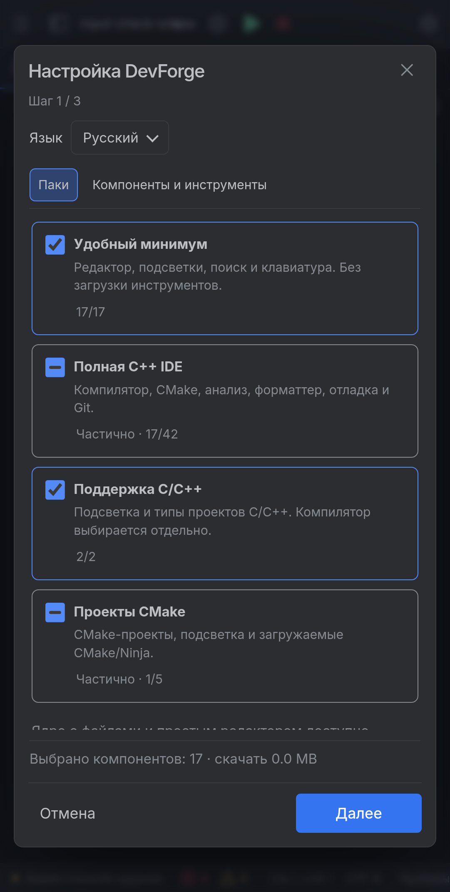
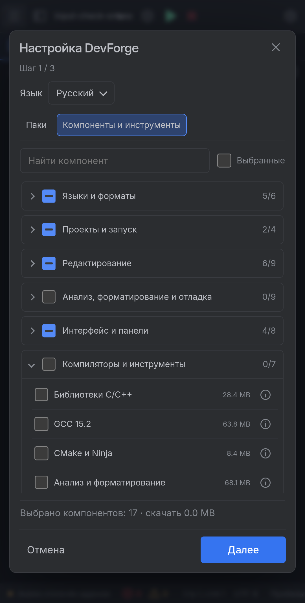

# 0.4.2: первый запуск и выбор компонентов

В первом запуске две вкладки: **Паки** и **Компоненты и инструменты**. Удобный минимум показан первым; отдельные настройки находятся на следующем необязательном шаге, в сворачиваемых группах. Последний шаг показывает состав и объём загрузок. Можно пропустить настройку.

У групп и паков три состояния: пустой квадрат, прочерк частичного выбора и галочка полного выбора. Галочки меняют план, а не запускают скачивание. Зависимости учитываются автоматически. При активном поиске групповая галочка относится только к найденным компонентам. Фильтр «Выбранные» показывает выбранный состав.

Выбор компонента обновляет существующие строки: раскрытые группы и прокрутка сохраняются. В мастере состояние вкладки, поиска, групп, настроек и прокрутки сохраняется между запусками. Черновики предыдущей версии преобразуются в новый трёхшаговый мастер. Ошибка подготовки сохраняет состав для повторной попытки.

Этот же выбор используется в менеджере аддонов. Каталог пакетов, установка из файла/HTTPS, выбор и удаление установленных версий, удаление отключённых инструментов и экспорт состава доступны отдельно. Дополнительные сведения скрыты за значком информации и раскрываемыми списками.

На телефоне кнопка проводника получила значок боковой панели: она больше не дублирует значок главного меню. Обе функции сохранены. Для новых настроек удержание экрана по умолчанию выключено; явно сохранённый выбор пользователя сохраняется.

## Проверка и границы

46 целевых проверок интерфейса выполнены в отдельном Android API 36 x86_64 эмуляторе: касания, Space для галочки, сохранение DOM/групп/прокрутки, холодный запуск, поиск, частичный состав, отмена, повтор после ошибки, меню и проводник. Проверены размеры 320×640, 390×740, 740×360 и 960×640, масштабы 100%, 125%, 150%. Отдельно выполнены проверки JavaScript/Java, лицензий, Gradle unit и release lint. [Машиночитаемый отчёт](../verification-devforge-042.json).

Для запуска UI в x86_64 эмуляторе использован отдельный debug APK: изменено только поле архитектуры в `assets/runtime-info.json`. Остальные файлы полезной нагрузки совпадают с debug-сборкой ARM64. Он не публикуется. Нативные инструменты ARM64 не скачивались и не запускались; это проверка интерфейса, а не компилятора в эмуляторе. Публикуемый release APK сохраняет исходную архитектуру ARM64 и прежнюю подпись. Физический планшет не использовался и не будился; его проекты и настройки не менялись.

В тестовом драйвере исправлено ожидание синтезированного Android touch-click и добавлена проверка видимости цели: ранняя версия драйвера нажимала по координатам скрытых элементов. Одна CDP-сессия оборвалась при снятии снимка после применения профиля; повторное подключение подтвердило сохранённый состав, снимок и оставшиеся проверки выполнены. Это не доказательство отсутствия всех зависаний.

Это preview интерфейса. Target SDK28 и предупреждение Android при чистой установке сохраняются. SDK аддонов остаётся 0.1.1: произвольные исполняемые сторонние моды, Python/ipynb и онлайн-маркетплейс ещё не реализованы. Нативный runtime и tool packs не менялись.
