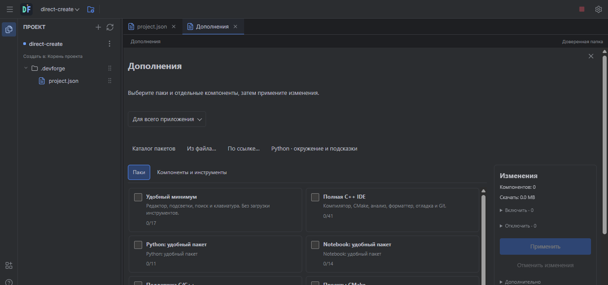

# Project management in local dev.4

Open the project selector and use the visible **⋯** button beside a project.
Right click opens the same menu; on Android a touch hold opens it too. Movement,
scrolling or a second finger cancels the hold. Text fields retain their normal
selection behavior.

**Remove from list — keep files** forgets the project without moving its folder.
**Move project to trash** first shows its exact path and asks for confirmation.
The folder moves into `.devforge-project-trash/<entry>/<project>` beside its
original location, on the same volume. This is DevForge's recoverable project
trash, not the operating system's trash. The selector's **Removed projects and
trash** entry restores either kind. A conflicting folder at the original location
is preserved and blocks restoration. Shared parent folders, protected roots and
folders containing another registered project cannot be moved by this action.
Project settings and ordinary local file history remain available for recovery.

The toolbar's folder-and-cog icon opens **Project settings**. It exposes run
configurations/profiles, additional project tools, attachable templates,
workspace trust and the raw `.devforge/project.json`. The run-configuration icon
uses a play symbol with controls; the application keeps its ordinary settings
gear.

**Create** no longer requires manually pressing Preview. It validates and prepares
the template when pressed. Preview remains optional for new projects. Existing-file
attachments retain a reviewed snapshot, collision checks and explicit replacement
choices. A suggested project name avoids names already in the project list;
creating a name that is already occupied on disk never overwrites that folder.

Ordinary application extensions are shared across projects. Compiler and
interpreter providers are installed once; project types/templates and run
configuration fields use their capabilities. A project's addon declaration adds
requirements to the application selection rather than replacing its UI tools.
Changing to a notebook therefore retains an application window manager. Projects
can still store their own layout and run/build configuration. **Attach template**
in Project settings can add formatter configuration, CMake parts or another
registered component after project creation.

The left **Extensions** icon opens the manager as a regular editor tab in either
interface mode. It uses the same packs/components picker and three-state groups.
Application extensions are the default scope; additional project requirements
remain explicitly labelled. A compiler/interpreter's installation belongs to the
application, while its executable choice and arguments belong to a project/run
profile.

New desktop build output lives in `build/debug` or `build/release` in the project.
Known old generated `.forge/cmake-debug` / `.forge/cmake-release` defaults migrate;
custom build paths remain unchanged. Execution's working directory remains the
project root. On Android shared storage, generated programs must still execute
from private staging: the final artifact is copied into the project's `build`
folder, while the executable staging and external CMake cache stay private.

The Windows GCC integration uses the complete compiler include search order when
clangd lacks resource headers. This avoids the reported `float.h` / `include_next`
failure without hiding diagnostics. C++23 builds link a found `libstdc++exp` after
the object/source arguments; CMake retains its existing standard libraries and
honors explicit overrides. `linkExperimentalLibrary: false` opts out. GCC 14
documents the Windows `std::print` requirement in its
[release notes](https://gcc.gnu.org/gcc-14/changes.html).

For notebooks, file-only W292/W391 end-of-file warnings are omitted for cells;
normal `.py` files keep these checks. Shell/magic placeholders do not produce a
false E402 before an import. Genuine Python statements before imports still do.

