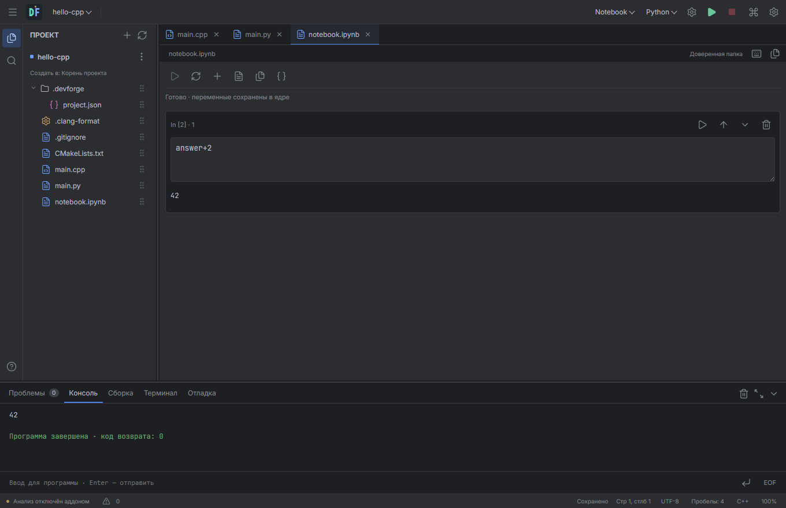

# Python, ноутбуки и современные платформы — alpha

Эта ветка продолжает DevForge 0.4.2. Это экспериментальный этап поддержки нескольких языков, **не стабильная замена предыдущей Android-сборки**. Текущий рекомендуемый предварительный Android-выпуск остаётся [0.4.2](https://github.com/Bony-Lord/devforge/releases/tag/v0.4.2).

## Python и Jupyter-файлы

В менеджере появились официальные паки **Python** и **Python и ноутбуки**: зависимости включают подсветку, тип проекта, запуск и ядро. C/C++ остаются отдельной специализацией. Новый проект Python создаёт `main.py` и конфигурацию запуска; notebook-проект создаёт `.ipynb`.

В профиле Python по умолчанию задан только запуск. При необходимости можно назначить действию сборки проверку синтаксиса без исполнения кода; без назначения кнопка сборки скрыта. Запуск выполняет сохранённый скрипт, передаёт аргументы и окружение, поддерживает обычный ввод консоли и использует корень проекта либо настроенную папку. На компьютере можно указать путь Python в настройках или использовать найденный системный интерпретатор.

`.ipynb` открывается **как документ в области кода**, в обычной вкладке файла. Он использует ту же панель и границы, что и код: окна поверх IDE и затемнения нет. Поддерживаются ячейки code/Markdown/raw, добавление, удаление, перемещение, запуск отдельной ячейки или всех, Shift+Enter, текстовый вывод, исключения с traceback, перезапуск ядра и переход к исходному JSON. Временное переключение на другой файл сохраняет представление ячеек. Закрытие файла освобождает его представление.

[Ячейка и её результат на Android](screenshots/0.5-alpha-notebook-android.png). Снимки содержат только интерфейс тестовой IDE, без системных часов и заряда устройства.

Python-процесс хранит переменные между выполнениями. Перезапуск уничтожает процесс и сбрасывает состояние, поэтому позволяет остановить бесконечный цикл. Открытие ноутбука ничего не исполняет. Для выполнения требуется доверие к папке; нативный/настольный backend проверяет его независимо от интерфейса.

Формат — Jupyter nbformat 4. Строковые и построчные поля источника читаются; метаданные, вложения и существующие rich outputs сохраняются при изменении ячеек. Вывод отображается как текст; HTML и JavaScript из ноутбука не исполняются. [Спецификация формата](https://nbformat.readthedocs.io/en/latest/format_description.html).

Это пока **Python-ядро DevForge, не полная реализация IPython/Jupyter**. Magics (`%…`, `!…`), виджеты, интерактивные rich outputs, выбор внешнего Jupyter-ядра, debugger Python и LSP уровня Pyright ещё не подключены. `input()` внутри ячейки сообщает об ограничении; интерактивные программы можно запускать как `.py`. Редактор ячеек сейчас использует текстовые поля; специализированная подсветка/анализ и более полная интеграция редактирования ячеек — следующий этап. Python-пак не устанавливает NumPy/pandas автоматически.

## Проект, интерфейс и действия запуска

Общие настройки запуска теперь находятся в `.devforge/project.json`. Старый `.cpp-studio/configurations.json` читается с переносом прежних действий; следующая запись создаёт новый файл, сохраняя старый. Новые документы без `actions.build/run/debug` не получают скрытых действий по умолчанию. Отсутствие действия или его активного провайдера скрывает кнопку и убирает команду из палитры; горячая клавиша ничего не запускает.

Провайдеры действий регистрируются официальными аддонами через `actionProviders` / `projects.actions`. Конфигурация выбирает их независимо для сборки, запуска и отладки. Перед запуском выполняется именно выбранная сборка, если включено `buildBeforeRun`; её ошибка прекращает запуск. Ручные команды используют массивы argv без неявной оболочки, рабочую папку, окружение и остановку процесса. Доступ к исполняемым сторонним провайдерам этим не открывается: внешний SDK пока принимает только проверяемые пакеты данных.

В менеджере аддонов можно выбрать «По умолчанию для проектов» или «Только этот проект». Последний сохраняет состав в `addons: {mode: "project", requested: [...]}`; наследование использует общий состав. Открытие проекта не загружает инструменты автоматически. Если профиль не может активироваться, включается пустой состав и показывается причина; исходный запрошенный состав остаётся в файле проекта для явного применения через менеджер.

`interface.mode` задаёт наследование, упрощённый или оконный интерфейс; аддон оконника должен быть включён. Раскладка панелей сохраняется отдельно для каждой папки на устройстве. Переключение оконного рабочего пространства пока требует управляемой перезагрузки интерфейса с сохранением документов. Форма профилей допускает C/C++ / CMake, интерпретатор и универсальный профиль; пустой проект не получает фиктивный компилятор. Типы и провайдеры новых языков могут расширять эту модель.

## Android

Сборка `modern` использует target SDK 36. Инструменты установлены PackageManager в каталоге нативных библиотек APK. Скомпилированная C/C++ программа собирается как shared program и выполняется отдельным установленным хостом через `dlopen`. Это сохраняет локальную компиляцию при ограничениях `execve` Android 10+. [Ограничение Android](https://developer.android.com/about/versions/10/behavior-changes-10#execute-permission).

Возвращены сохранённые нативный хост и установщик runtime; актуальные аддоны, доверие папке, клавиатура и оконник остаются из ветки 0.4.2. Обработан системный Back через OnBackInvokedDispatcher на API 33+, добавлены отступы системных панелей для edge-to-edge на новом target. Старый `compat` сохраняет target 28 и загрузку инструментов. В modern проверено продолжение после UBSan-предупреждений GCC/Clang; ASan для hosted-программ пока явно недоступен и выдаёт понятную ошибку.

**Размеры и доставка различаются.** Современный APK содержит нативные инструменты: их можно включать/отключать, но это не уменьшает APK. Перевод такой поставки в устанавливаемые отдельные пакеты ещё не закончен. В compat Python пока использует общий проверенный пакет runtime с GDB, поэтому его установка тяжелее минимального самостоятельного Python. Бинарники, загруженные в writable-каталог, нельзя просто запускать на target 36.

Повышение target устраняет конкретную причину предупреждения о старом SDK в modern APK. Проверка магазином Google Play, политика доступа ко всем файлам, подпись/репутация APK и Play Protect остаются отдельными вопросами; одобрение магазина не заявляется. [Требования target API](https://developer.android.com/google/play/requirements/target-sdk), [16 KB page size](https://developer.android.com/guide/practices/page-sizes).

## Компьютеры

Настольный backend перенесён из сохранённой ветки вместе с CMake file API, GDB/LLDB-адаптерами, файловой системой и заготовками установщиков. Сейчас он использует актуальный общий интерфейс, систему аддонов, доверие папке и notebook-модель. На Windows проверены реальные Python/GCC/GDB/CMake-процессы и интерфейс Electron. Для Linux/macOS добавлены отдельные CI-проверки переносимой файловой системы и Python; успешная такая проверка не означает проверку всех нативных установщиков и действий IDE на этих ОС.

Установщик Windows, deb и pkg остаются экспериментальной поставкой. Данные проекта хранятся в обычных папках. Компиляторы и Python на компьютере обнаруживаются в системе и не входят в установщик. Старый нестабильный 1.0.0-rc.1 и сохранённая rc.2 не объявляются стабильными этим этапом.

## Проверки

Код этапа: `c57125c7425c6cc46fd339a2fc43a353dd7dbba4`. [Подробный отчёт и ограничения](verification-0.5-alpha.json): 74 локальные группы проверок исходников, 24 сценария desktop UI и те же 24 для готового Windows-пакета, 29 проверок API36-эмулятора. [Source CI](https://github.com/Bony-Lord/devforge/actions/runs/40682647886) и [переносимые проверки Windows/Linux/macOS](https://github.com/Bony-Lord/devforge/actions/runs/40682647832) прошли. Проверки переносимого backend не подтверждают весь GUI и установщики на каждой ОС.

Проверки выполняются на отдельных проектах/данных. Физический планшет не использовался: его установленная версия и данные в этом этапе не менялись. Есть реальные тесты Python-процесса, сохранения переменных, traceback, остановки зависшей ячейки, nbformat round trip, доверия папке, интерфейса desktop и Android API 36 эмулятора, GCC/Clang и CMake на modern backend. 16 KB выравнивание проверяется для ARM64 ELF отдельно; работа на физическом устройстве с 16 KB страницами этим не подтверждается.

SDK сторонних аддонов остаётся 0.1.1 и форматом данных. Python и notebooks — официальные модули хоста; произвольные исполняемые сторонние моды и онлайн-маркетплейс не объявляются реализованными.
