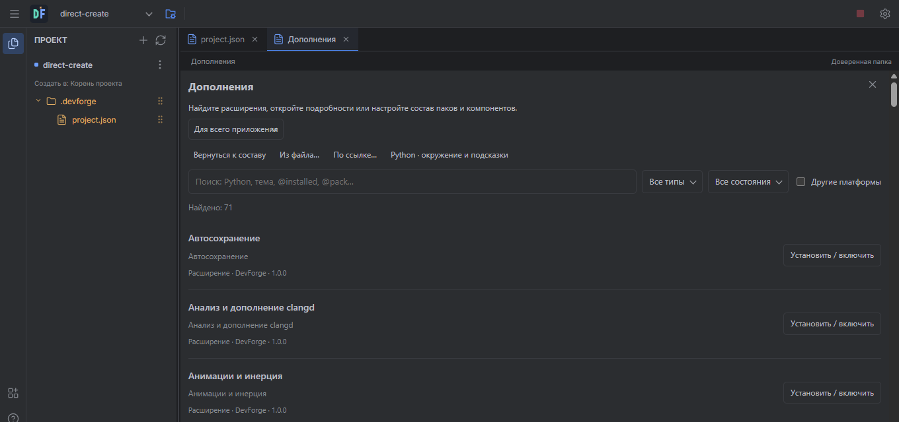
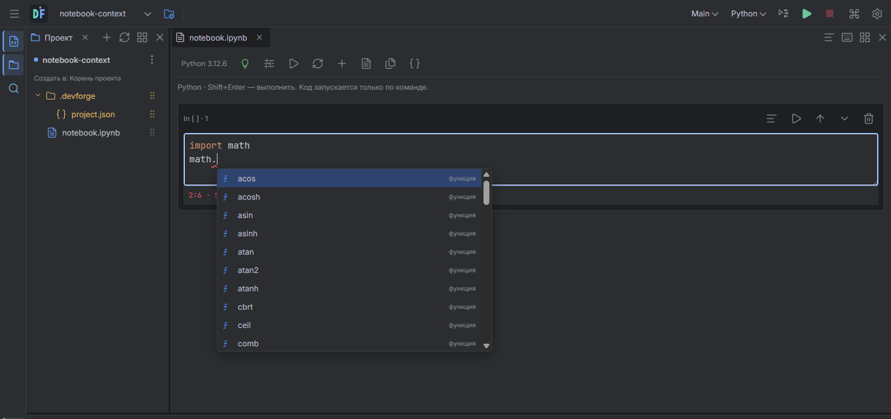

# DevForge 0.6.0-dev.5: workspace, extensions and notebook resources

This is a local development build. It has not been published or declared stable.

The project selector now searches project names and paths, exposes Open Folder,
and keeps the project list behind its nested actions. On desktop, opening another
project offers the current window or a separate window. Each window owns its
editor session and tool processes, with a shared application extension library.
Deleting a project open in another window is blocked until that window closes.
Multiple native Android activity windows are not implemented by this change.

Project actions distinguish keeping files, recoverable DevForge trash and permanent
deletion. Permanent deletion displays the path and requires the exact project name.
It removes the confirmed folder and all its contents; it does not remove sibling
folders. A failed partial deletion leaves the remainder in the recoverable archive.
The automated deletion checks operate only on temporary test projects.

New editor/project splits use approximately 5:1 horizontal space, including notebook
projects. Existing deliberate layouts are retained. Run settings have a fixed icon
button that remains accessible at narrower widths. Generated `build` directories
appear in the tree and the tree refreshes after builds. Compiled project templates
create `build` immediately. Dot folders and their descendants are yellow. Large
generated directories load on expansion instead of blocking the whole tree.

Both Create and Attach work without manually requesting Preview. A conflict still
requires choosing which files to replace; the reviewed source hashes are checked
again before writing. Python/notebook templates select the corresponding quality
pack, including the separately downloaded Jedi completion provider. Notebook typing
supports indentation, paired brackets and quotes, matching closer overtyping,
selected-text wrapping, paired deletion, undo and physical/virtual keyboard input.
Normal Python source uses the same pair rules where the editor has not inserted
the closing symbol itself.

The left Extensions button opens a searchable catalog inside an editor tab. Search
supports words, quoted phrases, `@installed`, `@enabled`, `@pack`, `@builtin` and
`@platform:win32`. Filters cover packs/extensions and installation/enabled state.
Unsupported platforms are hidden unless Other Platforms is selected; incompatible
installation stays disabled. Details show versions, license, dependencies, text
documentation and screenshots. Official screenshots are captures of temporary test
projects without system chrome. Third-party data packages may provide small inline
PNG/JPEG/WebP previews; arbitrary HTML and remote tracking images are not executed.
File/HTTPS import and the existing explicit third-party review remain available.
This is an in-app catalog and import workflow, not a newly deployed public hosting
service. The existing third-party format remains data-only; unrestricted executable
mods and a full third-party runtime SDK are unfinished.

CPython 3.12, 3.13 and 3.14 have separate, versioned desktop downloads. The installer
contains the catalog, not the interpreters. Downloads are platform/architecture
specific, pinned to size and SHA-256, installed privately and checked by executing
the interpreter before publishing its folder. System Python/PATH are unchanged.
The archives come from [Astral python-build-standalone](https://github.com/astral-sh/python-build-standalone/releases/tag/20260901),
which provides [portable Python distributions](https://docs.astral.sh/uv/concepts/python-versions/#managed-python-distributions).
Runtime files can be removed separately after stopping their users. Android keeps
its existing native Python tool-pack delivery. The notebook component is DevForge's
local persistent Python kernel with shell/magic support; it is not a full Jupyter
server or IPython implementation.

Notebook resource settings are stored in `metadata.devforge.resources`. Applying
them restarts the kernel and clears variables. Zero means unlimited.

| Control | Enforcement and scope |
| --- | --- |
| RAM, MiB | Windows Job Object committed-memory limit for the process/job. Linux/Android `RLIMIT_AS` limits process virtual address space. These are not measurements of physical RAM. |
| CPU, percent | Hard Windows Job Object CPU-rate cap, including the job's child processes. This local runner does not expose a hard percentage quota on Linux/Android/macOS. |
| GPU | Library-default access or hiding devices via CUDA/HIP/ROCm environment settings. An arbitrary GPU percentage quota is unavailable and is rejected rather than silently ignored. This does not prevent direct driver access or an environment override by trusted code. |
| Disk, MiB | Periodic size check of the configured working folder, including existing files. Symlinks are not followed. Exceeding the budget stops the kernel and retains all files; a write may exceed the budget before the next check. Writes outside the working folder are not covered. |
| Cell time | Wall-clock timeout for one running cell. Exceeding it terminates the kernel and cancels the cell. |
| Notebook time | Accumulated wall-clock execution across cells in the current kernel session; idle time between cells is excluded. Restart resets this budget. |

If a requested RAM/CPU hard limit cannot be applied, the kernel exits before it
executes user code. Limits are resource controls, not a security sandbox.
The Windows CPU rate follows [Microsoft's Job Object API](https://learn.microsoft.com/en-us/windows/win32/api/winnt/ns-winnt-jobobject_cpu_rate_control_information).
GPU device visibility follows [NVIDIA's CUDA environment interface](https://docs.nvidia.com/cuda/cuda-programming-guide/05-appendices/environment-variables.html).

Shortcuts now require the exact modifier combination. `Ctrl+F12` opens outline,
`Ctrl+Shift+F12` controls focus mode, and `Ctrl+Alt+Space` remains completion.
`Ctrl+Y` is left to redo; delete-line uses `Ctrl+Shift+K`. AltGr/composition input
does not launch IDE commands. Debugger alternatives use Ctrl+Alt combinations
instead of depending on Android keyboards exposing their F-key row. Hardware/OS
shortcuts intercepted before the app still cannot be overridden by a DOM handler.

Validation commands and platform limits are in [REGRESSION-TESTS.md](REGRESSION-TESTS.md).

